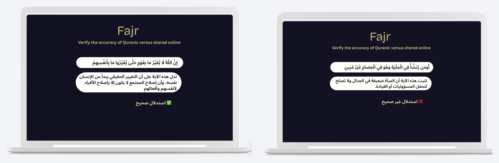

<div align="center">

# FAJR فجر 🌅📖

**AI-based System for Verifying Quranic Citations**

*Imam Mohammad Ibn Saud Islamic University · College of Computer and Information Sciences*

</div>

---

## 📍 About
Quranic verses are widely shared on social media, but many of these citations are incomplete, altered, or taken out of context, and even a small change in wording can affect the meaning. **Fajr** is an NLP system that checks a Quranic citation and tells the user whether it is **correct** or **incorrect**, then explains the decision.

---

<div align="center">



</div>

---

## 🌟 Key Features

- **Citation Verification** ✅: Classifies a Quranic citation as correct or incorrect
- **Fine-tuned AraBERT** 🧠: Arabic transformer model trained on authentic and manipulated citations
- **Explainable Results** 🔍: A `/explain` endpoint shows which parts of the input influenced the decision (LIME)
- **Web Interface** 🌐: Simple dark-themed page to submit a citation and see the result
- **Runs Locally** 💻: No dedicated server needed, only a standard computer

---

## 🧪 How It Works

1. **Input:** the user submits an Arabic text containing a Quranic citation.
2. **Preprocessing:** the text is normalized (unifying letter forms, removing diacritics and punctuation).
3. **Classification:** the fine-tuned AraBERT model reads the verse and the claim together and predicts the label.
4. **Explanation:** LIME highlights the words that affected the prediction.

**Dataset:** authentic verse and tafsir pairs from the [Quran-Tafseers](https://huggingface.co/datasets/riotu-lab/Quran-Tafseers) dataset, plus systematically generated incorrect samples that imitate common citation errors. The train/test split is done by unique verse to avoid data leakage.

**Result:** about **81%** test accuracy.

---

## 💻 Tech Stack

- 🐍 **Python 3.9+**
- 🤗 **Hugging Face Transformers** and **PyTorch**: fine-tuning AraBERT (`aubmindlab/bert-base-arabertv02`)
- 🌶️ **Flask**: web app and prediction API
- 🐼 **Pandas** and **Scikit-learn**: data handling and evaluation
- 🍋 **LIME**: explainability
- 🐙 **GitHub** and **VS Code**

---

## 📂 File Structure

```
fajr
├── DataCleaning.py                # Loads and normalizes the Quran/tafsir data
├── main.py                        # Fine-tunes AraBERT and saves the model
├── app.py                         # Flask app (/predict and /explain)
├── index.html                     # Web interface
├── train.csv / test.csv           # Training and test sets
├── tafsir_incorrect_final.csv.zip # Generated incorrect samples
├── real_data.csv                  # Real examples for evaluation
└── README.md
```

---


## 👥 Team

| Name | Role |
| --- | --- |
| Alshaimaa Alamer | Student, Group F17 |
| Anfal Alshmmari | Student, Group F17 |
| Dr. Wafa Alrajhi | Supervisor |

---


